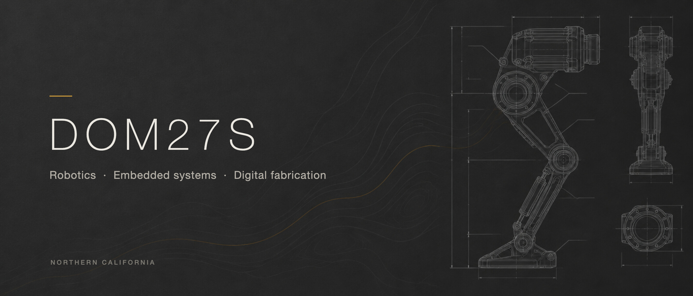

  

I design and build robots and the hardware around them: mechanical design, custom electronics, firmware, and control trained in simulation.

### Current work

| Area | Focus |
|:--|:--|
| **Robots** | Full-size rolling and walking builds |
| **Handheld devices** | ESP32-based field devices on custom carrier boards |
| **Locomotion** | Walking gaits trained in simulation, then run on hardware |
| **Fabrication** | Design for 3D printing on Klipper-based printers |

### Tools

Fusion · KiCad · OrcaSlicer · Klipper · ESP32 · MuJoCo · Python · Swift

Most repositories here are private.
