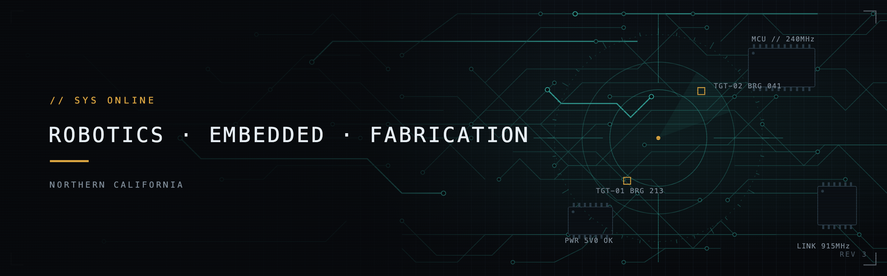

  

I build robots and the electronics that run them, from CAD and printed parts to custom boards, firmware and control.

**Working in**
- Mechanical design for 3D printing
- Custom PCBs and embedded firmware (ESP32, Raspberry Pi)
- Legged locomotion trained in simulation, then run on hardware
- Off-grid radio and mesh networking

**Tools:** Fusion · KiCad · Klipper · ESP32 · MuJoCo · Python · Swift

Most work here is private.
