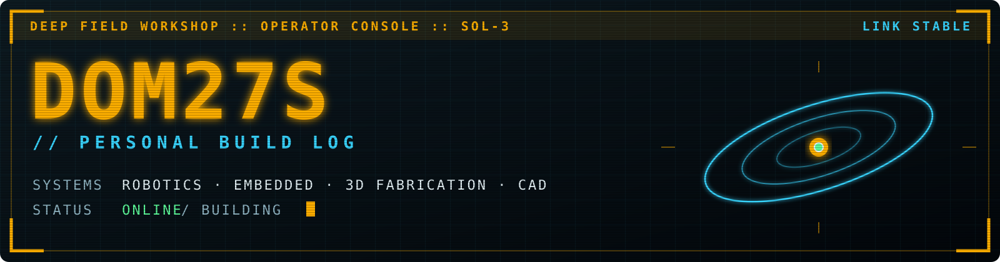

<p align="center">
  
</p>

```text
┌─ OPERATOR FILE ───────────────────────────────────────────────┐
  CALLSIGN ....... DOM27S
  AO ............. SOL-3 / NORTHERN CALIFORNIA
  ROLE ........... BUILDER / OPERATOR
  ROE ............ BUILD IT. TEST IT. MAKE IT WALK.
└───────────────────────────────────────────────────────────────┘
```

### `>_` ACTIVE OPERATIONS

| OP | OBJECTIVE | STATUS |
|:--|:--|:--|
| **DROID** | Full-size rolling and walking robot builds | `IN FABRICATION` |
| **HANDHELD** | ESP32 field devices on custom carrier boards | `PROTOTYPE` |
| **GAIT** | Simulation-trained walking, sim to hardware | `TRAINING` |
| **FORGE** | CAD for print, Klipper-driven printers | `OPERATIONAL` |

### `>_` LOADOUT

| CAD / PCB | FABRICATION | FIRMWARE | SIM / CODE |
|:--|:--|:--|:--|
| `Fusion` `KiCad` | `OrcaSlicer` `Klipper` | `ESP32` | `MuJoCo` `Python` `Swift` |

<sub><code>// COMMS: CLOSED CHANNEL &nbsp;·&nbsp; MOST REPOSITORIES CLASSIFIED (PRIVATE) &nbsp;·&nbsp; END TRANSMISSION</code></sub>
